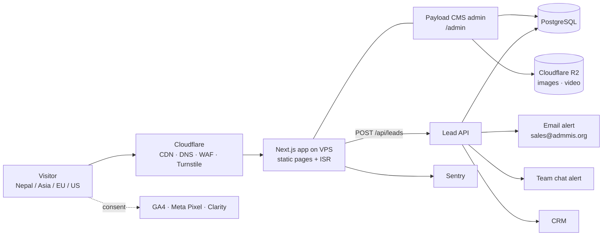
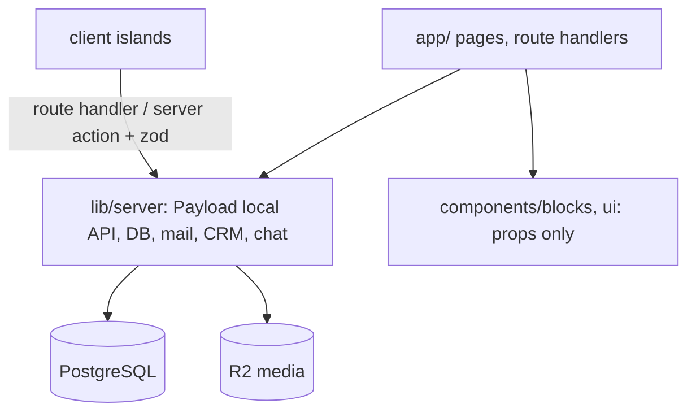

# Architecture

## System overview

One application (Next.js + Payload) in Docker on a **VPS in the Mumbai region**, deployed to **production** (`tech.admmis.org`) and **staging** by GitHub Actions. Database and media backed up **every 24 hours** to R2. 2FA on every account (ADR-017).

## Why it will be fast
- Pages are **pre-built HTML** served from Cloudflare's edge. Editors publish in the CMS → page rebuilds in seconds (ISR).
- Image pipeline: AVIF/WebP, responsive sizes, lazy loading below the fold.
- Fonts self-hosted and subset; no render-blocking third-party scripts; analytics load after consent.
- **Performance budget (enforced in CI):** Lighthouse mobile ≥ 90, LCP < 2.5 s on 4G, JS < 150 KB on content pages.
- Tested on a budget Android phone, not just developer laptops.

## Reusable templates (no hand-built pages)
Every page is assembled from CMS **blocks**: Hero, Services grid, Case cards, Pricing table, Testimonials, FAQ, CTA + form, Logo strip, Rich text, Video.

| Template | Used for |
|---|---|
| Home | `/` |
| Service hub | `/services` |
| Service page | `/services/{slug}` — one template, many pages (FITTIN has ~100) |
| Case study list / detail | `/work`, `/work/{slug}` |
| Pricing | `/pricing` |
| Blog list / article | `/blog`, `/blog/{slug}` |
| Simple page | about, careers, contact, legal |

## Content model (CMS collections)
`services` · `serviceCategories` · `rentalPlans` (by size band) · `hourlyRates` · `cases` · `clients` · `testimonials` · `pricingPackages` (NPR + USD) · `posts` · `faqs` · `teamMembers` · `jobs` · `leads` · `media` · `pages` · global `siteSettings` (menu, footer, contacts) · SEO fields on every document.

## Lead pipeline
1. Visitor submits form (name, company, email/phone, service, budget range, message). Turnstile blocks bots.
2. `POST /api/leads` validates input server-side and saves to `leads` **first**.
3. Then sends notifications: email to sales + team-chat message. A failed notification is retried; the lead is never lost.
4. Lead is pushed to the CRM; status tracked there.
5. Analytics conversion event fires (GA4 + Meta) with source/UTM.
6. Visitor sees a thank-you state plus a WhatsApp click-to-chat button.

Phase 2: route leads into ADMIS (our own CRM platform).

## Security & compliance
- Secrets only in environment variables / password manager, never in the repo or in client-side JS.
- Cookie consent banner (GDPR-style) — needed for EU/US visitors.
- Privacy policy (Nepal Individual Privacy Act 2075 + GDPR basics), terms, cookie policy.
- CMS admin behind strong passwords + 2FA; role-based access (admin / editor / sales).

## Hero visual (AI model in sari)
Supplied by Founder. Needed: high-resolution transparent PNG (≥ 2000 px tall), 2–3 poses, optional 5–10 s loop video (MP4/WebM). We'll export AVIF/WebP and keep a record of how it was generated (tool, prompt, date) for rights clarity.

---

## Technical architecture (T-101, hritik, v0.1, 2026-11-06)
Detail lives in `docs/standards.md` (rules), `docs/scaffold-plan.md` (versions, build steps), `docs/ci-spec.md` (quality gates). Items marked PROPOSED wait for Roshan's ADR.

### Repo and runtime
- **One repository, one Next.js app, Payload embedded** under `src/app/(payload)`; no monorepo (PROPOSED). PostgreSQL via Payload's Postgres adapter. Node 24 LTS (PROPOSED). Folder map: `docs/standards.md` §2.
- **Multi-brand (ADR-013/019):** one codebase for all deployments. The brand is chosen per deployment by `src/brands/<brand>/` plus env `BRAND`. Client rentals are separate deployments (own database, own env) of this repo, not forks. Whether any case ever needs a fork is an open point in standards §5.

### Layers and boundaries

- Only `lib/server` touches DB, Payload local API or secrets (`server-only` guard). Components never fetch.
- Env is parsed once in `lib/env.ts` with zod; the app fails at boot on missing keys.
- Zod schemas in `lib/schemas` are shared by the form (client) and the route handler (server).

### Rendering and caching
- Public pages are static/ISR. Payload `afterChange` hooks call `revalidatePath`/`revalidateTag` on publish, so edits go live in seconds (see "Why it will be fast").
- Cloudflare caches HTML at the edge for anonymous traffic; `/admin`, `/api/*` and previews bypass cache. Cache rules are Raj's (T-501).
- Dynamic exceptions: `/api/leads`, `/api/health`, draft preview, search (if added later).
- Admin routes are a separate route group so Payload's JS does not count against the 150 KB public budget.

### Routing and i18n (ADR-004)
`app/(site)/[locale]/…`. English unprefixed, Nepali under `/ne/` (assumption from `seo/sitemap.md`, Mahendra confirms in T-302). Content fields localized in Payload from day one; UI strings in `src/messages/<locale>/`. Template names from the sitemap (`home`, `services-hub`, `service`, `pricing`, `rent-hub`, `rent-product`, `cases-list`, `case`, `blog-list`, `article`, `careers-list`, `job`, `event`, `faq`, `about`, `contact`, `thank-you`, `legal`, `error`) map to route files under `(site)/[locale]/`; Mahendra owns the final map in T-301.

### Theming (ADR-013)
Tailwind v4 `@theme` tokens as CSS variables; the active brand's `tokens.css` is imported by `styles/globals.css`. Components use token utilities only. Satish details in T-202.

### Pricing data (ADR-014)
One `pricing` source in Payload: packages, rental plans, hourly rates, in NPR and USD, as integer minor units. Pages and blocks reference price documents by relation; nothing is typed into content.

### Lead pipeline (ADR-007) in code
`POST /api/leads` → verify Turnstile → zod parse → rate limit → insert into `leads` (this step must succeed before anything else) → enqueue notifications (email, chat, CRM) with retry and status per channel on the lead record → return `201`. Notification failure never fails the request. Logs carry the lead ID only. Contract: `docs/api/leads.md` (Neha, T-402).

### Consent-gated analytics (ADR-006)
A small client island reads the consent state and only then injects GA4, Meta Pixel and Clarity. Before consent no third-party request is made. Event names and parameters come from Sudip's spec; helper lives in `lib/analytics`.

### Environments
`local` (Docker Postgres) → `staging` → `production`, all the same Docker image with different env. Secrets only in env/password manager. `.env.example` lists names only. Health endpoint `/api/health` for uptime checks. Sentry for errors, with PII scrubbing.

### Risks to watch
| Risk | Mitigation |
|---|---|
| Payload/Next/TypeScript version incompatibility | Smoke tests and fallback pins in scaffold plan §6 |
| JS budget vs animations and Payload | Admin in separate route group; Satish proposes any animation library with its size; CI blocks > 150 KB |
| VPS single point of failure | 24 h backups, restore drill (Raj), Cloudflare in front |
| Devanagari typography late surprise | Font and layout tests with Nepali sample text from the first templates |
