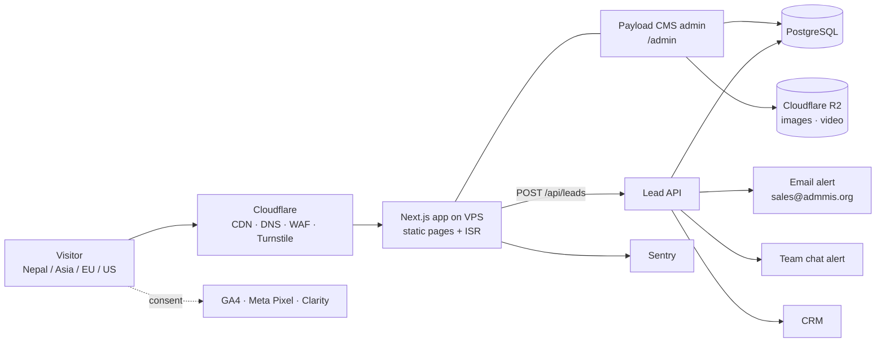

# Architecture

## System overview

One application (Next.js + Payload) in Docker on a **VPS in the Mumbai region**, deployed to **production** (`tech.admmis.org`) and **staging** by GitHub Actions. Database and media backed up **every 24 hours** to R2. 2FA on every account (ADR-017).

## Why it will be fast
- Pages are **pre-built HTML** served from Cloudflare's edge. Editors publish in the CMS → page rebuilds in seconds (ISR).
- Image pipeline: AVIF/WebP, responsive sizes, lazy loading below the fold.
- Fonts self-hosted and subset; no render-blocking third-party scripts; analytics load after consent.
- **Performance budget (enforced in CI):** Lighthouse mobile ≥ 90, LCP < 2.5 s on 4G, JS < 150 KB on content pages.
- Tested on a budget Android phone, not just developer laptops.

## Reusable templates (no hand-built pages)
Every page is assembled from CMS **blocks**: Hero, Services grid, Case cards, Pricing table, Testimonials, FAQ, CTA + form, Logo strip, Rich text, Video.

| Template | Used for |
|---|---|
| Home | `/` |
| Service hub | `/services` |
| Service page | `/services/{slug}` — one template, many pages (FITTIN has ~100) |
| Case study list / detail | `/work`, `/work/{slug}` |
| Pricing | `/pricing` |
| Blog list / article | `/blog`, `/blog/{slug}` |
| Simple page | about, careers, contact, legal |

## Content model (CMS collections)
`services` · `serviceCategories` · `rentalPlans` (by size band) · `hourlyRates` · `cases` · `clients` · `testimonials` · `pricingPackages` (NPR + USD) · `posts` · `faqs` · `teamMembers` · `jobs` · `leads` · `media` · `pages` · global `siteSettings` (menu, footer, contacts) · SEO fields on every document.

## Lead pipeline
1. Visitor submits form (name, company, email/phone, service, budget range, message). Turnstile blocks bots.
2. `POST /api/leads` validates input server-side and saves to `leads` **first**.
3. Then sends notifications: email to sales + team-chat message. A failed notification is retried; the lead is never lost.
4. Lead is pushed to the CRM; status tracked there.
5. Analytics conversion event fires (GA4 + Meta) with source/UTM.
6. Visitor sees a thank-you state plus a WhatsApp click-to-chat button.

Phase 2: route leads into ADMIS (our own CRM platform).

## Security & compliance
- Secrets only in environment variables / password manager, never in the repo or in client-side JS.
- Cookie consent banner (GDPR-style) — needed for EU/US visitors.
- Privacy policy (Nepal Individual Privacy Act 2075 + GDPR basics), terms, cookie policy.
- CMS admin behind strong passwords + 2FA; role-based access (admin / editor / sales).

## Hero visual (AI model in sari)
Supplied by Founder. Needed: high-resolution transparent PNG (≥ 2000 px tall), 2–3 poses, optional 5–10 s loop video (MP4/WebM). We'll export AVIF/WebP and keep a record of how it was generated (tool, prompt, date) for rights clarity.
